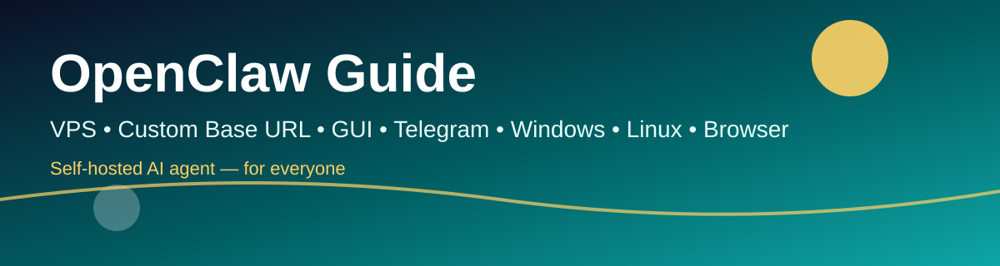
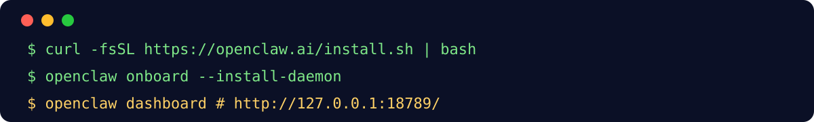

# OpenClaw Guide



> OpenClaw ကို VPS ပေါ်မှာ Custom Base URL API နဲ့ သုံးနည်း၊ GUI နဲ့ Telegram ကနေ သုံးနည်း၊ Windows / Linux / VM မှာ သုံးနည်း၊ Browser Control ပေးနည်းကို မြန်မာဘာသာဖြင့် အပြည့်အစုံ ရေးထားတဲ့ လမ်းညွှန်။

**Website:** https://openclaw-guide.funapp.live
**PDF:** [site/openclaw-guide.pdf](site/openclaw-guide.pdf)


## ဒီ Guide မှာ ဘာပါလဲ

| အခန်း | အကြောင်း |
|---|---|
| 01 | OpenClaw ဆိုတာ ဘာလဲ၊ Gateway 18789 |
| 02 | VPS ပေါ် Install |
| 03 | Custom Base URL Provider |
| 04 | GUI — Control UI |
| 05 | Telegram Bot |
| 06 | Windows |
| 07 | Linux နဲ့ VM |
| 08 | Browser Control |
| 09 | လုံခြုံရေး နဲ့ ပြဿနာဖြေရှင်းနည်း |



## အမြန်စတင်

Linux / macOS / WSL2:

```bash
curl -fsSL https://openclaw.ai/install.sh | bash
openclaw onboard --classic --install-daemon
openclaw gateway status
openclaw dashboard
```

Windows PowerShell:

```powershell
iwr -useb https://openclaw.ai/install.ps1 | iex
```

## Custom Base URL — အတိုချုပ်

OpenClaw မှာ provider တစ်ခု ကို `~/.openclaw/openclaw.json` ထဲမှာ ဒီလို ရေးတယ်။ တကယ့် key ကို ဒီမှာ မရေးပါနဲ့။

```json
{
  "models": {
    "providers": {
      "myprovider": {
        "baseUrl": "https://api.example.com/v1",
        "api": "openai-completions",
        "models": [{ "id": "your-model-id", "name": "your-model-id" }]
      }
    }
  },
  "agents": {
    "defaults": {
      "model": { "primary": "myprovider/your-model-id" }
    }
  }
}
```

အပြည့်အစုံကို [docs/03-custom-base-url.md](docs/03-custom-base-url.md) မှာ ကြည့်ပါ။ Template အပြည့်ကို [templates/openclaw.json.example](templates/openclaw.json.example) မှာ ကြည့်ပါ။


## လုံခြုံရေး — အရေးကြီးဆုံး ၃ ခု

1. Gateway port **18789 ကို public internet မှာ ဘယ်တော့မှ မဖွင့်ပါနဲ့**။ SSH tunnel, nginx + HTTPS + basic auth, ဒါမှမဟုတ် Tailscale နဲ့ပဲ ဖွင့်ပါ။
2. API key နဲ့ Telegram bot token ကို GitHub, chat, screenshot ထဲမှာ ဘယ်တော့မှ မတင်ပါနဲ့။
3. `~/.openclaw/openclaw.json` ကို backup ယူထားပါ။ ဖိုင် permission ကို 600 ထားပါ။

## License

MIT — လူတိုင်း သုံးနိုင်တယ်၊ ပြင်နိုင်တယ်၊ ပြန်မျှဝေနိုင်တယ်။

## One-click Install (အသစ်)

Linux:
```bash
git clone https://github.com/mymyanmarland/openclaw-guide.git
cd openclaw-guide
bash scripts/install.sh --base-url https://api.example.com/v1 --model your-model-id
```

Windows PowerShell:
```powershell
git clone https://github.com/mymyanmarland/openclaw-guide.git
cd openclaw-guide
.\scripts\install.ps1 -BaseUrl https://api.example.com/v1 -Model your-model-id
```

Script က official installer, key verify, config backup, provider merge, Telegram (optional), gateway start, wait until ready, channel probe အကုန် လုပ်ပေးတယ်။ အရင် စမ်းချင်ရင် `--dry-run` / `-DryRun` နဲ့ စမ်းပါ။
